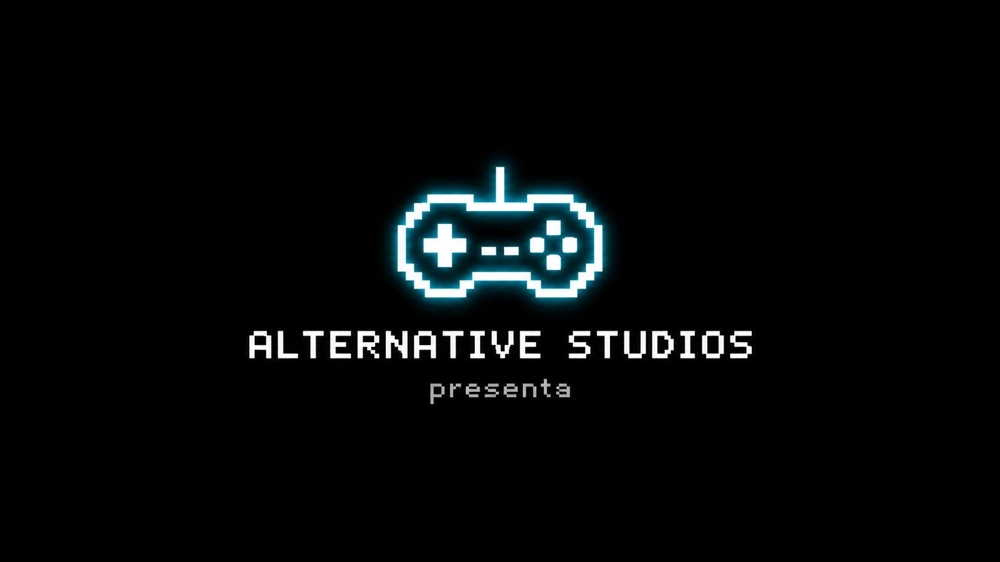
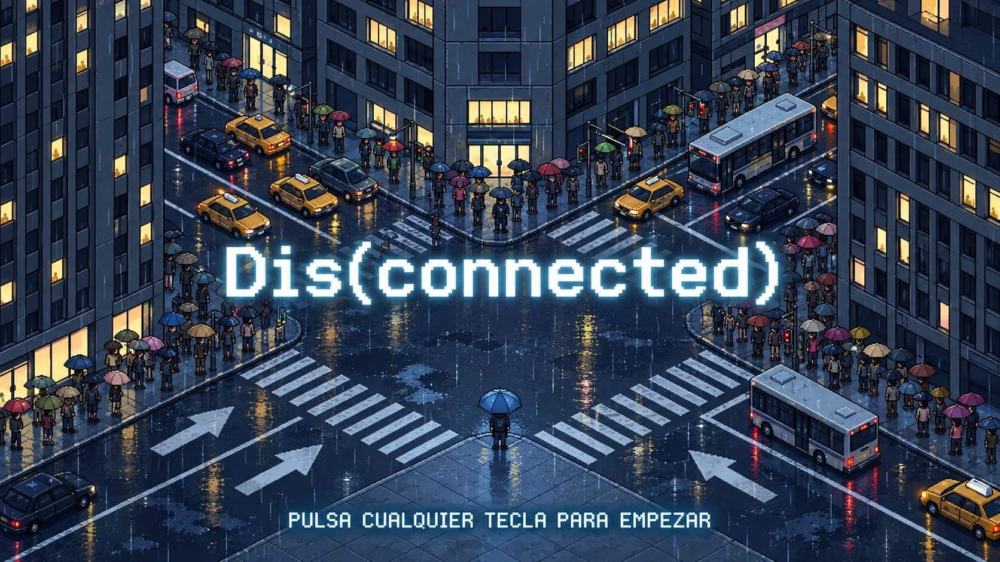
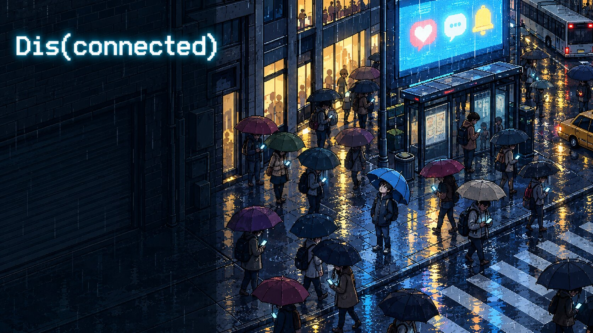
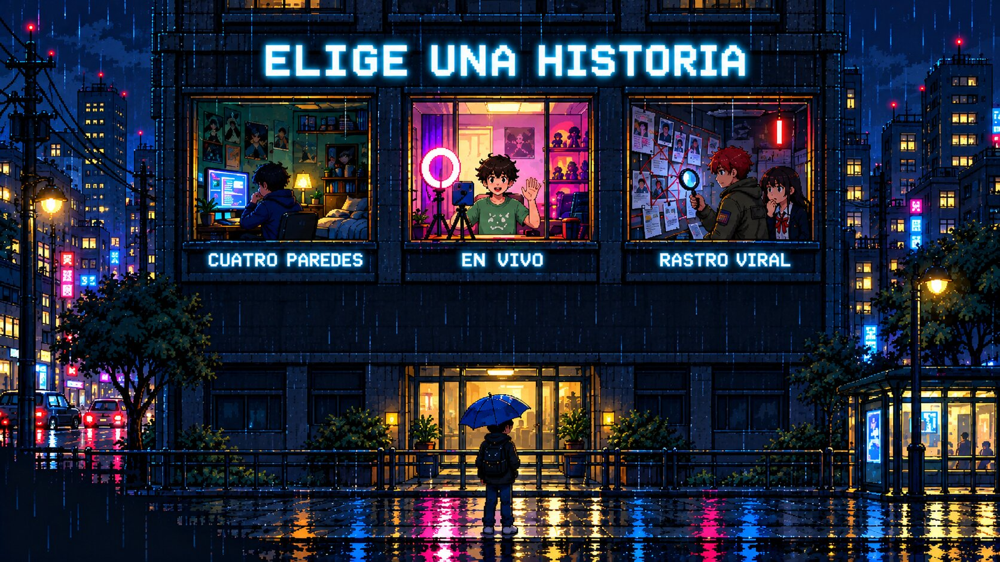
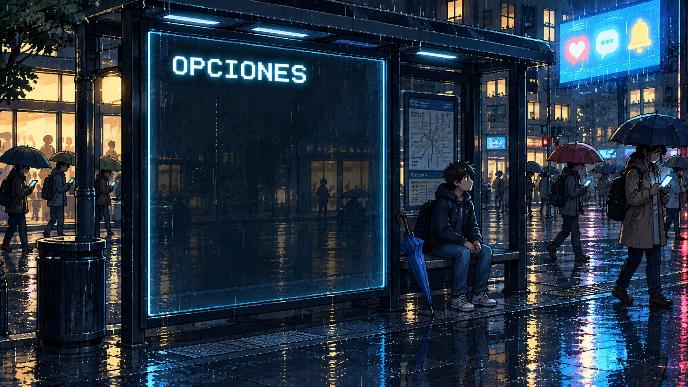
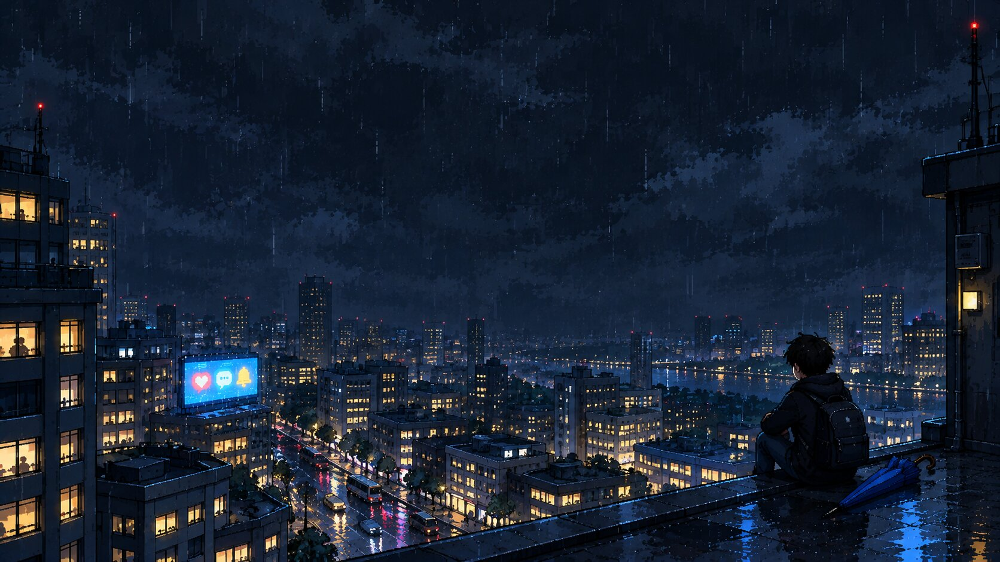

<div align="center">



# Dis(connected)

**Tres historias. Un mismo sábado lluvioso. Una pregunta: ¿quién controla a quién, tú o tu pantalla?**

Videojuego 2D en pixel art sobre el uso saludable de las redes sociales.


**Alternative Studios** · Equipo 8 · Algoritmia y Programación II · Universidad del Norte

</div>

<br>

<div align="center">
  
</div>

---

## Índice

- [Sobre el juego](#sobre-el-juego)
- [Las tres historias](#las-tres-historias)
- [El minijuego de mensajes](#el-minijuego-de-mensajes)
- [Capturas](#capturas)
- [Cómo jugar](#cómo-jugar)
- [Cómo correrlo](#cómo-correrlo)
- [Estructura del proyecto](#estructura-del-proyecto)
- [Cómo está hecho el código](#cómo-está-hecho-el-código)
- [Trabajo en equipo con GitHub](#trabajo-en-equipo-con-github)
- [Fechas](#fechas)
- [Equipo](#equipo)
- [Créditos](#créditos)

---

## Sobre el juego

**Dis(connected)** es un juego de modo historia. Escoges una de tres historias, cada una sobre un problema distinto de las redes sociales: la adicción a la pantalla, el odio en línea y la desinformación.

En cada historia tomas **decisiones** que cambian lo que pasa, juegas **minijuegos** y llegas a uno de **dos finales**, con una reflexión al terminar. Las tres historias ocurren **el mismo sábado lluvioso en la misma ciudad**, y sus personajes se cruzan: lo que pasa en una deja rastros en las otras.

> El objetivo no es dejar las redes, es aprender a usarlas sin que te usen a ti.

---

## Las tres historias

| | Historia | Protagonista | Tema |
|:-:|---|---|---|
| 🟢 | **CUATRO PAREDES** | Leo, 17 años | Adicción a la pantalla y aislamiento |
| 🟣 | **EN VIVO** | Mateo, 19 años, streamer | El odio que recibes y cómo respondes |
| 🔴 | **RASTRO VIRAL** | Un investigador cibernético que ayuda a Sofía, 17 años | Desinformación, evidencia digital y denuncia |

### 🟢 Modo 1 — CUATRO PAREDES
Leo lleva semanas encerrado jugando, a pocas victorias de subir de rango. El lunes, Sofía, su mejor amiga, lo invita a su cumpleaños el sábado en el parque. La historia avanza **día por día durante esa semana**, y el cuarto de Leo cambia según lo que decidas: de la oscuridad del monitor a la luz de la ventana abierta… o no.

*Minijuegos:* lluvia de notificaciones, **Limpieza express** (mouse) y **Romper el bucle** (teclado).

### 🟣 Modo 2 — EN VIVO
Mateo está en pleno stream cuando un usuario encapuchado lo ataca con bots. El chat, sediento de drama, le pide que responda con odio, y cada vez que lo hace la audiencia sube. Tú decides entre **los números y su paz mental**.

*Minijuegos:* lluvia del chat, **Caza de bots** (mouse) y **Control de daños** (teclado).

### 🔴 Modo 3 — RASTRO VIRAL
Una captura falsa de WhatsApp, donde supuestamente Sofía insulta a los profesores y filtra un examen, circula por todo el colegio. Como investigador, sigues el rastro digital para encontrar al responsable y decidir **cómo usar las pruebas**.

*Minijuegos:* contención del rumor, **Análisis forense** y **Cadena de reenvíos**.

> Jugar las tres historias tiene premio: en los finales buenos, los personajes de las otras historias pueden aparecer.

---

## El minijuego de mensajes

Es el corazón del juego y aparece en las tres historias, cada vez con otro aspecto. Llueven mensajes hacia tu avatar y tienes que reaccionar:

| Mensaje | Qué hace | Tecla |
|---|---|:-:|
| 🔴 **Negativo** | Si te llega, baja tu bienestar | **B** para bloquearlo |
| 🟢 **Positivo** | Da puntos y bienestar (bloquearlo te penaliza) | **C** para capturarlo |
| ⚪ **Neutro** | No suma ni resta, pero distrae | — |
| 🚨 **Reportar** | Se activa con 3 negativos seguidos y borra todos los rojos | **R** |
| ⏸️ **Pausa** | Detiene el juego | **P** |

Si tu bienestar llega a **0**, es **Game Over** y puedes volver a intentarlo.

---

## Capturas

<table>
  <tr>
    <td align="center"><br><sub><b>Menú principal</b></sub></td>
    <td align="center"><br><sub><b>Elegir historia</b></sub></td>
  </tr>
  <tr>
    <td align="center"><br><sub><b>Opciones</b></sub></td>
    <td align="center"><br><sub><b>Créditos</b></sub></td>
  </tr>
</table>

---

## Cómo jugar

| Acción | Control |
|---|---|
| Elegir botones y opciones | **Mouse** (click) |
| Saltar la intro / pasar al menú | **Cualquier tecla** o **click** |
| Volver a la pantalla anterior | **ESC** |
| Subir o bajar el volumen | Flechas **<** y **>** en *Opciones* |
| Minijuego de mensajes | **B**, **C**, **R**, **P** |

---

## Cómo correrlo

1. Instala **[Processing 4](https://processing.org/download)**.
2. Instala la librería de sonido: en Processing, `Sketch → Importar biblioteca → Gestionar bibliotecas…`, busca **Sound** (de The Processing Foundation) e instálala.
3. Abre `Disconnected/Disconnected.pde`.
4. Dale **Run** (▶). El juego abre en pantalla completa y se adapta a cualquier resolución.

> 💡 Mientras desarrollamos, **TAB** muestra arriba a la izquierda los FPS y la posición del mouse en coordenadas de 1920 × 1080, para ubicar botones.

---

## Estructura del proyecto

```
disconnected-game/
├── Disconnected/                ← el juego
│   ├── Disconnected.pde         variables generales, setup(), funciones de ayuda y draw()
│   ├── Pantallas.pde            intro, menú, opciones, créditos y elegir historia (lo que se dibuja)
│   ├── Controles.pde            teclado y mouse: keyPressed(), mouseReleased() y sus ayudantes
│   ├── Modo1.pde                CUATRO PAREDES
│   ├── Modo2.pde                EN VIVO
│   ├── Modo3.pde                RASTRO VIRAL
│   └── data/
│       ├── fondos/              fondos JPG (1920 × 1080)
│       ├── retratos/            personajes PNG con fondo transparente
│       ├── fuentes/             Press Start 2P y VT323
│       └── audio/               música del menú
├── docs/                        documento del equipo, guía del laboratorio e informe
└── README.md
```

### Números de pantalla

| Número | Pantalla |
|:-:|---|
| 0 | Intro: logo de Alternative Studios → pantalla de título |
| 1 | Menú principal |
| 2 / 3 | Opciones / Créditos |
| 4 | Elegir historia |
| 5 – 19 | Libres (instrucciones, pausa, etc.) |
| 20 – 39 | Modo 1: CUATRO PAREDES |
| 40 – 59 | Modo 2: EN VIVO |
| 60 – 79 | Modo 3: RASTRO VIRAL |
| 90 | Game Over |

---

## Cómo está hecho el código

El código está pensado para que **cualquiera del equipo lo pueda leer y explicar**: simple, ordenado y comentado en español.

- **Una variable decide todo:** `int pantalla`. `draw()` solo mira su valor y llama a la función de esa pantalla.
- **Funciona en cualquier pantalla:** todas las posiciones están en 1920 × 1080 y se multiplican por `escalaX` y `escalaY`. Las funciones `rectE()` y `escribir()` lo hacen solas.
- **Sin trabas:** imágenes y fuentes se cargan **una sola vez** en `setup()`. Cada tamaño de letra es su propia fuente (`titulo56`, `texto40`…), porque cambiar `textSize()` en cada frame traba el juego.
- **Botones:** cada pantalla revisa con `mouseEncima()` qué botón está bajo el mouse y lo guarda en una variable; `mouseReleased()` lee esa variable para saber qué se clickeó. Sobre un botón, el cursor cambia a la manito.
- **Transiciones:** `cambiarPantalla(n)` cambia de pantalla con un degradado desde negro y prende o apaga la música.
- **Estilo:** condicionales con `else { if }` anidado y arreglos solo donde ayudan (por ejemplo, los 4 botones del menú).

Las reglas completas están en [`docs/Disconnected_Documento_Equipo.docx`](docs/Disconnected_Documento_Equipo.docx).

---

## Trabajo en equipo con GitHub

1. **Antes de empezar:** *Fetch* y *Pull* en GitHub Desktop.
2. **Después de un Pull:** cierra y vuelve a abrir el sketch en Processing (no recarga los archivos solo).
3. **Avisa en el grupo** qué pestaña vas a tocar. Si cada uno trabaja en una pestaña distinta, no hay conflictos.
4. **Al terminar algo pequeño:** *Commit* con un mensaje claro y *Push*. Varias veces al día.
5. **Si aparece un conflicto:** no borres nada a ciegas; avisa al grupo.

---

## Fechas

| | Fecha |
|---|---|
| 🎮 Juego terminado | **2 de noviembre de 2026** |
| 📦 Entrega | **3 de noviembre de 2026** |

---

## Equipo

<div align="center">

### Alternative Studios

| Luisa Fernanda Mercado Royert | Germán Samuel Nieto Mejía | Sebastián Andrés Molina Arteta |
|:-:|:-:|:-:|

Algoritmia y Programación II · Universidad del Norte · 2026-II

</div>

---

## Créditos

- **Fuentes:** [Press Start 2P](https://fonts.google.com/specimen/Press+Start+2P) y [VT323](https://fonts.google.com/specimen/VT323), de Google Fonts, con licencia SIL Open Font License.
- **Imágenes y música:** generadas con herramientas de inteligencia artificial y elegidas por el equipo.
- **Hecho con** [Processing](https://processing.org).

<div align="center">
<br>
<sub>Hecho con ☕ y muchas horas frente a la pantalla (con pausas, como debe ser).</sub>
</div>
